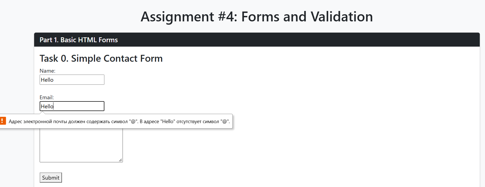
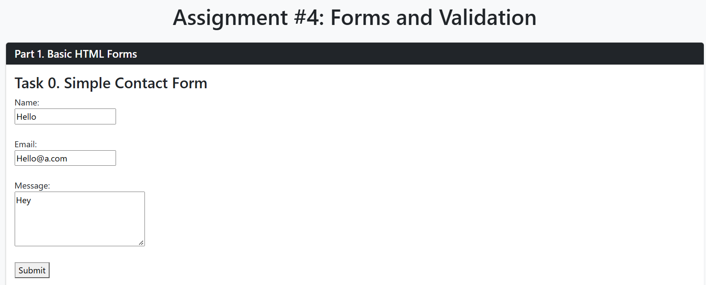

<h1>
    Aidynuly Makhambet  
    IT-2504 
    Github Pages: https://aidynulymakhambet.github.io/Assignment-4-WEB/
</h1>

<h2>Part 1</h2>
<h3>Task 0</h3>

If there nothing after "@" it will throw warning and won't send message.

If everything right it will go to "#" file - message is "sent".

<h3>Task 1</h3>

Email validation.

Validation of symbol amount

This will take person to a "#' page, kind of "send" function.

<h2>Part 2</h2>
<h3>Task 2</h3>

Email validation

<h3>Task 3</h3>

Bootstrap styled validation warning. Instead of browser default one.

<h2>Part 3</h2>
<h3>Task 4</h3>

Another bootstrap powered validation.